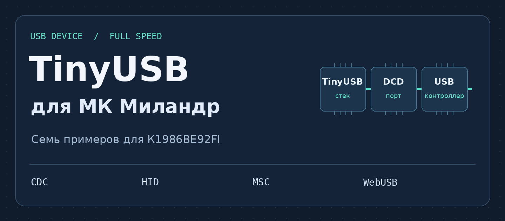
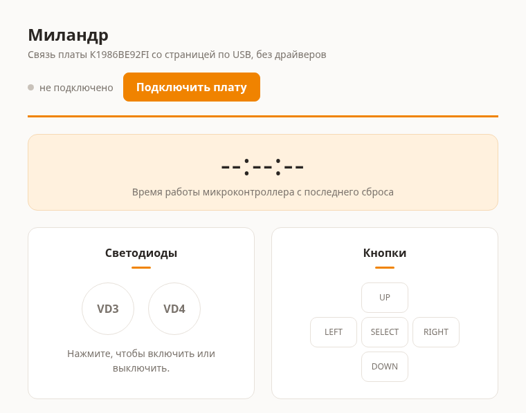

# TinyUSB для микроконтроллеров Миландр

Семь USB-прошивок для отладочной платы **К1986ВЕ92FI**. Все цели используют общий [порт TinyUSB 0.21.0](src/tusb_MDR32Fx.c) и собираются из одного [проекта Keil µVision](USB_EXAMPLES.uvprojx).

[Примеры](#примеры) · [Сборка](#сборка) · [Как устроен порт](#как-устроен-порт) · [Проверка](docs/testing.md) · [Статья на портале Миландр][article]

## Демо · USB-диск и управление из браузера

В режиме **MSC_WEBUSB** плата появляется как USB-диск. Откройте `index.htm` с этого диска в Chrome или Edge и нажмите **Подключить плату**. Страница управляет светодиодами, отображает нажатия кнопок и строит график показаний АЦП встроенного датчика температуры. Файлы страницы лежат во Flash в образе FAT12, поэтому демо работает офлайн. [Как запустить демо и пересобрать образ](examples/msc-webusb/README.md).

## Примеры

| Цель Keil | USB-интерфейс | Что можно попробовать |
| --- | --- | --- |
| `CDC_ONLY` | CDC ACM · виртуальный COM-порт | Открыть терминал, вызвать `help` или включить режим эха. [Код](examples/cdc-only/) |
| `HID_MOUSE` | HID · мышь | Управлять курсором кнопками платы. [Код](examples/hid-only/) |
| `HID_KEYBOARD` | HID · клавиатура | Перемещаться стрелками и вводить демонстрационный текст. [Код](examples/hid-only/) |
| `MSC_ONLY` | MSC · диск FAT12 в ОЗУ | Читать и записывать файлы на USB-диске. [Код](examples/msc-only/) |
| `WEBUSB_ONLY` | Vendor · WebUSB | Управлять платой из страницы, запущенной на `localhost`. [Запуск](examples/webusb-only/README.md) |
| `MSC_HID` | MSC + HID | Записать `TEXT.TXT` на диск и нажать **SELECT**, чтобы плата ввела его как клавиатура. [Код](examples/msc-hid/) |
| `MSC_WEBUSB` | MSC + WebUSB | Открыть интерфейс управления с USB-диска, доступного только для чтения. [Запуск](examples/msc-webusb/README.md) |

## Сборка

1. Установите **Keil MDK / µVision 5** с **Arm Compiler 5.06**. В проекте указан Arm Compiler 5.06 update 7.
2. Установите CMSIS Device Family Pack **Milandr.MDR32FxQI 1.3.2** с поддержкой устройства `K1986VE92xI`. Исходники TinyUSB уже входят в репозиторий. Пакет предоставляет компоненты запуска, SPL и алгоритм прошивки.
3. Откройте [USB_EXAMPLES.uvprojx](USB_EXAMPLES.uvprojx), выберите цель и соберите проект. В **Manage Run-Time Environment** доступны драйверы **RST_CLK**, **PORT**, **USB** и **ADC**. Компонент **ADC** используется в демонстрациях WebUSB.
4. В настройках цели выберите свой отладчик и загрузите прошивку на плату. Подключите кабель к USB-разъёму устройства. Файлы сборки каждой цели появляются в `Objects/<цель>/`.

## Как устроен порт

Приложение задаёт конфигурацию стека и USB-дескрипторы. TinyUSB обрабатывает запросы хоста и вызывает драйвер контроллера устройства (DCD). [Драйвер Миландр](src/tusb_MDR32Fx.c) работает с контроллером через SPL, обрабатывает прерывания USB и обслуживает EP0–EP3. Исходники приложений лежат в [examples/](examples/), а [examples/example_main.c](examples/example_main.c) подключает приложение выбранной цели.

- **Управление готовностью точек.** У контроллера общий бит `EPRDY` для IN и OUT. Драйвер выставляет его после постановки передачи, учитывает состояние FIFO и удерживает STALL до сброса со стороны стека.
- **Составное устройство с тремя точками данных.** В `MSC_WEBUSB` накопитель использует EP1 OUT и EP2 IN, состояние платы передаётся через EP3 IN, а команды светодиодам идут управляющим запросом через EP0.
- **Подключение WinUSB.** Дескрипторы Microsoft OS 1.0 позволяют Windows автоматически назначить встроенный драйвер интерфейсу WebUSB.

Порт рассчитан на семейства **К1986ВЕ9х** и **К1986ВЕ1х**. Семь целей в этом проекте настроены на **К1986ВЕ92FI**. Поддерживается режим **USB Device Full Speed**. Изохронные передачи и remote wakeup выходят за рамки текущей реализации. Примеры используют тестовый VID `0xCAFE`.

## Проверка

В [tools/](tools/) есть скрипты для циклов переэнумерации, нагрузки на CDC и проверки накопителя, а также генератор FAT12-образа. [Команды для проверки на плате](docs/testing.md).

## Источники

Порт и примеры описаны в статье команды Миландр «Разработка USB-устройств на МК Миландр с TinyUSB: 7 готовых примеров». [Статья и оригинальный архив][article].

В проекте используется [TinyUSB 0.21.0](https://github.com/hathach/tinyusb/tree/0.21.0). Лицензия MIT относится к исходникам TinyUSB со своими уведомлениями об авторских правах. [Текст лицензии TinyUSB](docs/TinyUSB-LICENSE.txt).

[article]: https://support.milandr.ru/base/primenenie/programmirovanie-32-razryadnykh-mk/rabota-s-usb/69543/
